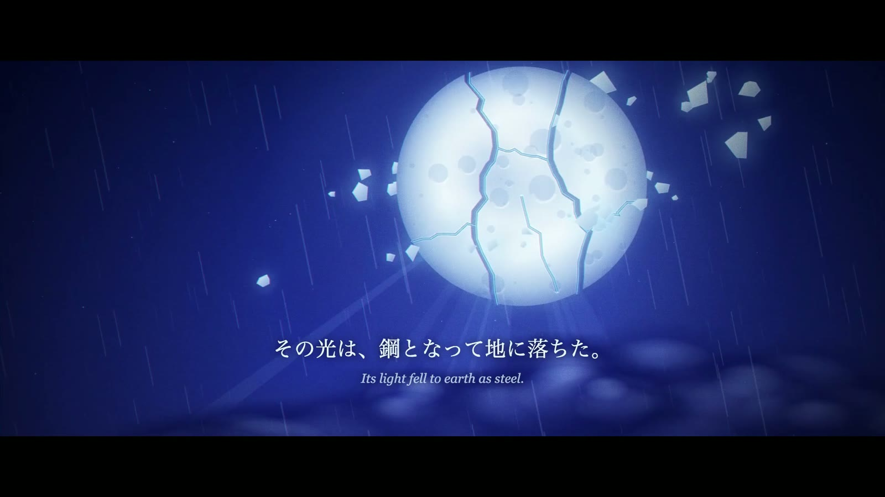
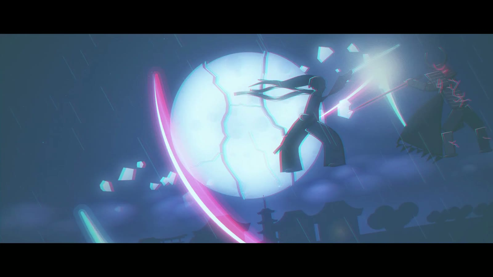
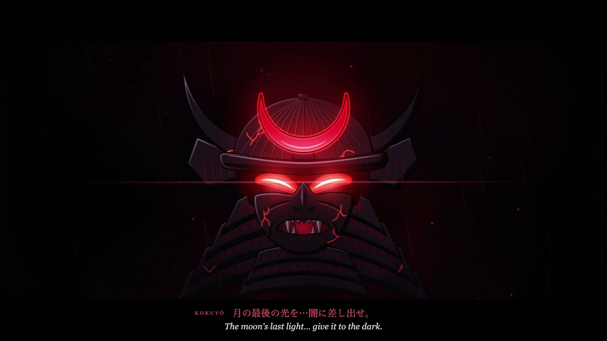
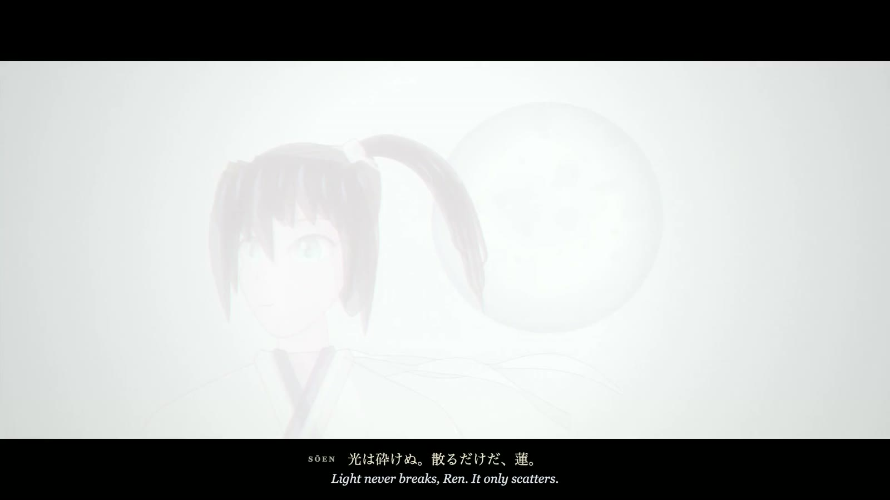

<h1 align="center">html-anime</h1>

<p align="center">
  <b>Prompt an anime. Your coding agent draws it in code.</b>
</p>

<p align="center">
  <a href="https://github.com/blixvip/html-anime/stargazers"></a>
  <a href="https://blixvip.github.io/html-anime/"></a>
  <a href="LICENSE"></a>
  
  
  <a href="https://discord.gg/grokbot"></a>
</p>

<p align="center">
  <a href="https://blixvip.github.io/html-anime/"></a>
</p>

<p align="center">
  <sub>A still from <i>Kokuyō</i>, drawn entirely in HTML. <a href="https://blixvip.github.io/html-anime/">Watch it on the site</a> · <a href="media/film.mp4">media/film.mp4</a></sub>
</p>

<p align="center">
  🛠 <b>Built in the open</b> — 5 contributors · 16 good first issues · we review PRs within 24h → <a href="https://github.com/blixvip/html-anime/issues/17">start here</a>
</p>

An anime, written as HTML. You write a scene. [The site](https://blixvip.github.io/html-anime/) turns it into a shot sheet: holds, one expensive shot, a closed color script. Paste that sheet into Claude, Codex, Cursor, or Grok. The agent draws the frames.

The pictures are HTML, timed for [HyperFrames](https://github.com/heygen-com/hyperframes). Nothing here calls a video model.

## The film

Kokuyō. Watch it on [the site](https://blixvip.github.io/html-anime/) or open [media/film.mp4](media/film.mp4).

<table>
  <tr>
    <td width="50%"></td>
    <td width="50%"></td>
  </tr>
  <tr>
    <td width="50%"></td>
    <td width="50%"></td>
  </tr>
</table>

## Start

Use **Node.js 20 or newer** for the Node commands below.

```
git clone https://github.com/blixvip/html-anime.git
cd html-anime
```

Open the folder in the agent you already use and paste a sheet as the first message. The site builds the sheet in the browser. `harness/compile.js` builds the same sheet in Node.

Serve the site from this folder, then open the address it prints:

```
python -m http.server
```

Opening `index.html` as a file shows that same instruction. The sheet will not run until the folder is served.

Or build a sheet in Node with the dependency-free sheet compiler (the film pipeline below uses npm dependencies):

```js
import { compileBrief } from "./harness/compile.js";

const sheet = compileBrief({
  logline: "On a roof in the rain, a red moon opens and a line of light falls.",
  seconds: 8,          // 8, 12, or 20
  aspect: "16:9",      // or "9:16"
  script: "indigo",    // indigo, eclipse, noon, or festival
  dialogue: "The rain hid the sound of the blade.",
});
console.log(sheet.ok ? sheet.markdown : sheet.error);
```

| Agent | What it reads | Open |
| --- | --- | --- |
| Claude Code | `CLAUDE.md` | `claude` |
| Codex | `AGENTS.md` | `codex` |
| Cursor | `.cursor/rules/html-anime.mdc` | `cursor .` |
| Grok | `AGENTS.md` | `grok` |

## Film pipeline

The multi-scene pipeline starts from a JSON film manifest. From the repository root:

```sh
npm install
npm test
```

Rendering also needs **FFmpeg and ffprobe on `PATH`**, plus Chromium:

```sh
npx playwright install chromium
npm run film:full
```

Alternatively, set `CHROMIUM_PATH` to your system Chromium executable, as described in
[Local end-to-end render](docs/LOCAL_RENDER.md). `film:full` runs preview generation,
rendering, then assembly; its example output is `build/final/moonlight-promise.mp4`.
The output is silent: audio mixing is not implemented. The example captures 1,440
frames at 1920×1080 and 24 FPS, so a full render takes more time and disk space than
the sheet compiler or the tests. Only render trusted local scene HTML.

| Command | Stage and output |
| --- | --- |
| `npm run film:demo` | Compile the manifest into shot sheets and `timeline.json` in `build/moonlight-promise/`; this does not draw HTML or render video. |
| `npm run film:preview` | Generate deterministic scene HTML and `timeline.json` in `build/preview/`. |
| `npm run film:render` | Capture the preview scenes frame by frame and encode silent scene MP4s in `build/rendered/`. |
| `npm run film:assemble -- build/preview/timeline.json build/rendered build/final/moonlight-promise.mp4` | Validate the scene files and concatenate them into the final silent MP4. |

For prerequisites, individual stages and current limitations, read
[Local end-to-end render](docs/LOCAL_RENDER.md). The
[Short Film Engine plan](docs/SHORT_FILM_ENGINE_PLAN.md) and
[Rendering integration roadmap](docs/RENDERING_NEXT.md) record the design and
earlier milestones; their planned audio and production features are not a claim
that those features are implemented.

## What is in the repo

- `index.html` — the site
- `skills/html-anime-direct/SKILL.md` — which shots exist
- `skills/html-anime-cel/SKILL.md` — how a frame is painted
- `skills/html-anime-timing/SKILL.md` — twos, holds, the smear
- `skills/html-anime-camera/SKILL.md` — the cut and the frame
- `skills/html-anime-render/SKILL.md` — the HyperFrames file
- `harness/compile.js` — logline to sheet
- `harness/film.js` and `harness/film-cli.mjs` — film manifest to timeline and per-scene shot sheets
- `harness/preview-film.mjs` — timeline to scene HTML
- `harness/render-film.mjs` and `harness/assemble-film.mjs` — scene HTML to silent scene MP4s, then the assembled film
- `media/film.mp4` — Kokuyō, the film
- `media/city.jpg`, `media/moon.jpg`, `media/fight.jpg`, `media/helm.jpg`, `media/ren.jpg` — stills from it
- `films/roof/` — an 8 second reference. File shape and the color-dip cut, not a film to remix
- `AGENTS.md` — the contract

## Test

```
npm test
```

Checks shot-sheet durations and contents, multi-scene timeline compilation, preview generation,
and assembly validation. The tests do not require Chromium or FFmpeg; they do not render a film.

## Render the reference

```
cd films/roof
npx hyperframes preview
```

Lint before you trust a new film:

```
npx hyperframes lint
npx hyperframes validate
```

## Sheet rules the agent is not allowed to break

- Shot times sum to 8, 12, or 20 seconds
- One sakuga shot. The others stay on three drawings
- Acting on twos. Rain and a blade on ones
- Only the hexes printed on the sheet
- The line you wrote, verbatim, or no dialogue at all

## Contributors

[](https://codespaces.new/blixvip/html-anime?quickstart=1)

Thank you to everyone who has helped build html-anime. New here? Read [CONTRIBUTING.md](CONTRIBUTING.md) and pick one of the [good first issues](https://github.com/blixvip/html-anime/issues?q=is%3Aissue+is%3Aopen+label%3A%22good+first+issue%22).

<a href="https://github.com/blixvip/html-anime/graphs/contributors"></a>

## Community

**Want to send a PR? Join the [blix open source Discord](https://discord.gg/grokbot) first.** It's the one server for everyone contributing to any blixvip repo: questions, ideas, PR discussion, help, and release news.

💬 [Join the Discord](https://discord.gg/grokbot) for questions, help, feedback, and updates.

<!-- more-from-blixvip:start -->

<!-- discord-incentive:start -->
### 💬 Why join the Discord first

**[discord.gg/grokbot](https://discord.gg/grokbot)** is the one server for every blixvip repo, and it gets you more than a chat window:

- 🟢 **Claim an issue and it is yours.** Say which one in `#contributors` and it is assigned to you, so two people never build the same thing twice.
- 🏷️ **A contributor role** on the server the moment your first pull request is merged.
- 🗺️ **A say in what gets built.** The roadmap is argued out there before it turns into issues.
- 🙋 **A human to ask.** Stuck on setup, or unsure whether an idea is even wanted? Faster than waiting on an issue thread.
<!-- discord-incentive:end -->

## More from blixvip

| Project | What it does |
| --- | --- |
| **[GenMotion](https://github.com/blixvip/GenMotion)** | Type an idea, get a finished motion-graphics video. Top Western + Chinese image models, your own API keys. |
| **[NullMotion](https://github.com/blixvip/NullMotion)** | Play a finished motion-graphics ad in sync with the rough drafts it grew from. Export the breakdown as MP4. |
| **[MotionClone](https://github.com/blixvip/MotionClone)** | Rebuild any reference video as an editable HyperFrames project and compare it against the original. |
| **[easyedit](https://github.com/blixvip/easyedit)** | Type a movie name, get a fan edit: captioned speech cut, then a montage cut to the beat. |
| **[stick](https://github.com/blixvip/stick)** | Free, open-source stick figure animation software for Windows, Linux and the web. |
| **[thumbnail-studio](https://github.com/blixvip/thumbnail-studio)** | A minimal Windows workspace for YouTube thumbnails: ChatGPT beside your references. |
| **[blixtrade](https://github.com/blixvip/blixtrade)** | Open-source core of BLIX, the AI memecoin terminal for Solana, with a public API and MCP server. |

<sub>If one of these helped you, a ⭐ helps other people find it. Follow [@waselyyy](https://x.com/waselyyy) for new drops.</sub>
<!-- more-from-blixvip:end -->

## License

[MIT](LICENSE). The reference film's font keeps its own license: see [films/roof/fonts/NOTICE.txt](films/roof/fonts/NOTICE.txt).
